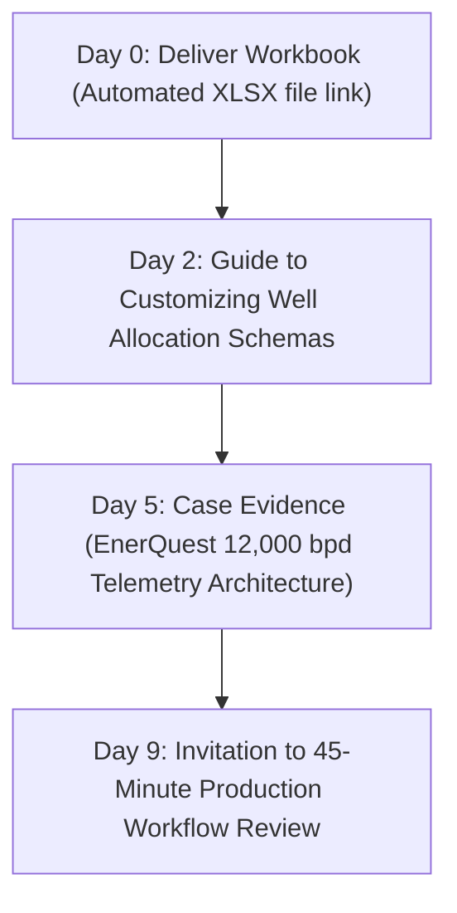

# Campaign Brief 01: Production Visibility (Nigeria & Angola)

**Campaign Name:** West Africa Digital Oilfield & Production Visibility  
**Target Markets:** Nigeria (NUPRC / NCDMB) & Angola (ANPG / Sonangol)  
**Primary Focus:** Independent Upstream Operators, Marginal Field Concessionaires, Indigenous E&P  
**Strategic Lead:** Lead with Nigeria and Angola leveraging EnerQuest operating proof  

---

## 1. Campaign Objective & Core Offer

| Parameter | Specification |
|---|---|
| **Core Productized Offer** | **45-Minute Production Workflow Review** |
| **Conversion Asset (Lead Magnet)** | Upstream Production System Requirements Workbook (`LM-01`) |
| **Owner Page** | `/en/industries/oil-and-gas/regions/west-central-africa` & `/en/industries/oil-and-gas/markets/nigeria` |
| **Asset Deliverable** | `Deview_Upstream_Production_Requirements_v2026.xlsx` |
| **Proof Anchor** | **EnerQuest Operating Proof:** Production telemetry monitoring 12,000+ bpd across remote wellpads with intermittent satellite connectivity, automated back-allocation, and zero cloud data lock-in. |
| **Target Next Action** | Book a structured 45-minute technical review of well testing, loss deferment, and telemetry intake logic. |

---

## 2. Target Accounts & Ideal Customer Profile (ICP)

### Primary Account Tiers:
- **Tier 1 (Nigerian Indigenous Operators & Independents):** Seplat Energy, Aiteo Group, Oando PLC, First E&P, ND Western, Waltersmith Petroman, Aradel Holdings (Niger Delta Petroleum), Amni International.
- **Tier 2 (Angolan Indigenous & Independents):** Somoil (Soyo Energy), Etu Energias, Sonangol P&P, Acrep, Petromar.
- **Tier 3 (Local Engineering & EPC Contractors):** Dorman Long, Kaztec Engineering, Nestoil, Ponticelli Angola, Friedlander.

### Target Personas:
1. **Asset General Manager / Field Superintendent:** Needs daily production reconciliation without 4-hour spreadsheet delays or discrepancy arguments between field logs and terminal custody meters.
2. **VP Production / Petroleum Engineering Director:** Focused on well test back-allocation formulas, dynamic decline curves, and statutory NUPRC / ANPG production reporting.
3. **IT / Automation Lead:** Concerned with remote telemetry reliability, VSAT link dropouts, and hosting sovereign data on-premise or in local certified clouds.

---

## 3. Core Narrative & Positioning

### The Pain Point:
In Nigeria and Angola, offshore platforms and remote swamp/inland flowstations frequently lose satellite connectivity. Traditional Western cloud-native production software breaks down during bandwidth dropouts, while legacy manual spreadsheets lead to unverified hydrocarbon allocation disputes, untracked loss deferments, and delayed regulatory filings.

### Deview Solution & Customizability:
Deview builds **custom, sovereign production management systems** designed for low-bandwidth and air-gapped realities:
- **Local Edge Telemetry Buffering:** Remote flowstations continue logging wellhead pressures and separator volumes during outages and burst-sync upon reconnection.
- **100% Client Source Code Ownership:** Zero recurring per-well licensing fees. Full intellectual property transfer.
- **Automated NUPRC / ANPG Compliance:** Daily, monthly, and annual reporting schemas generated directly from field-validated custody meters.

---

## 4. Distribution Engine

### A. Founder-Led LinkedIn Publishing Schedule (3x / Week)

#### Post 1 (Operational Reality):
- **Hook:** *“Why 60% of digital oilfield projects in the Niger Delta fail to deliver real-time visibility.”*
- **Angle:** Critique SaaS vendors selling cloud-only dashboards to platforms with 128 kbps VSAT links. Explain local edge buffering, SQLite local cache, and asynchronous burst-sync architecture.
- **Asset CTA:** Link to download the *Upstream Production Requirements Workbook*.

#### Post 2 (Technical Deep Dive - Telemetry & Diode Architecture):
- **Hook:** *“The physics of hydrocarbon back-allocation: Why static well potential formulas cost operators thousands of barrels in partner disputes.”*
- **Angle:** Walk through dynamic well test reconciliation vs custody transfer meter shrinkage. Share anonymized calculation diagrams.
- **Offer CTA:** Offer the *45-Minute Production Workflow Review*.

#### Post 3 (Proof & Case Spotlight):
- **Hook:** *“How EnerQuest monitors 12,000 bpd across remote well sites without vendor cloud lock-in.”*
- **Angle:** Breakdown of the telemetry topology, sensor intake (Modbus/OPC-UA), and operator daily sign-off workflow.
- **Asset CTA:** Direct link to explore the Nigeria concessions engineering overview.

---

### B. Curated Account-Based Outreach (1:1 Technical Outreach)

#### Sequence Strategy:
- **Channels:** LinkedIn InMail + Verified Corporate Email.
- **Cadence:** 3 touchpoints over 10 business days.
- **Message Tone:** Peer-to-peer technical engineering note (no generic marketing spam).

#### Sample Touchpoint 1 (The Operational Diagnostic):
> *Subject: Upstream production allocation & telemetry architecture for [Company]*  
> *Hi [First Name],*  
> *Most independent operators managing mature and marginal assets in [Nigeria / Angola] struggle with two recurring bottlenecks: manual spreadsheet reconciliation between field flowstations and export terminals, and software downtime during satellite dropouts.*  
> *We designed a testable engineering workbook specifically for evaluating upstream production and allocation systems against intermittent field connectivity:*  
> *https://deviewai.com/en/resources/upstream-production-system-requirements*  
> *It includes the exact telemetry buffering and back-allocation criteria we implemented for EnerQuest (monitoring 12,000+ bpd). Would you find it helpful to run a 45-minute production workflow review with our systems architects to map your current intake points?*  
> *Best regards,*  
> *[Deview Energy Practice]*

---

### C. 4-Step Email Nurture Sequence (Post-Workbook Download)

1. **Email 1 (Day 0 - Immediate Delivery):**
   - *Subject:* Your Deview Upstream Production Management Requirements Workbook
   - *Body:* Direct download link to `Deview_Upstream_Production_Requirements_v2026.xlsx`. Overview of the 6 sections (Asset hierarchy, SCADA intake, back-allocation, loss deferment, approvals, statutory filings).
2. **Email 2 (Day 2 - Implementation Guidance):**
   - *Subject:* How to evaluate your well test allocation math (Section 3)
   - *Body:* Guidance on configuring dynamic well potential curves vs static test rates. Common failure modes in joint venture audits.
3. **Email 3 (Day 5 - Operational Proof):**
   - *Subject:* Managing 12,000 bpd with edge telemetry: The EnerQuest architecture
   - *Body:* Architectural teardown: sensor acquisition at the wellhead, unidirectional diodes, and offline-first mobile inspection logs.
4. **Email 4 (Day 9 - Productized Conversion):**
   - *Subject:* Complimentary 45-minute production workflow review for [Company]
   - *Body:* Invitation to review the client's completed requirements workbook with Deview's senior petroleum systems architects. Direct link to schedule via Calendly (`/en/contact?topic=production-workflow-review`).

---

## 5. Metrics & Conversion Milestones (First 60 Days)

- **Target Workbook Downloads:** ≥45 verified corporate E&P emails.
- **Lead Qualification Target:** ≥20 MQLs / SQLs (concession operators or verified service primes).
- **Productized Review Conversion:** ≥6 completed 45-minute production workflow reviews.
- **Pipeline Influence:** ≥2 qualified RFP or scoping opportunities initiated.
