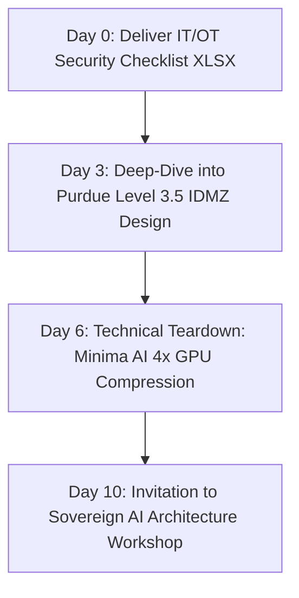

# Campaign Brief 02: Sovereign Industrial AI (UAE & Saudi Arabia)

**Campaign Name:** GCC Sovereign Industrial AI & Air-Gapped Field Intelligence  
**Target Markets:** United Arab Emirates (Abu Dhabi / Dubai) & Saudi Arabia (Eastern Province / Riyadh)  
**Primary Focus:** Regional Energy Systems Integrators, EPC Digital Contractors, Independent Asset Operators  
**Strategic Positioning:** Architecture-led, sovereign data residency, private on-premise LLM execution. **Strictly avoid any claims that imply existing direct delivery to ADNOC or Saudi Aramco.**  

---

## 1. Campaign Objective & Core Offer

| Parameter | Specification |
|---|---|
| **Core Productized Offer** | **Sovereign AI Architecture Workshop & IT/OT Integration Boundary Review** |
| **Conversion Asset (Lead Magnet)** | Oil & Gas IT/OT Architecture & Industrial Security Checklist (`LM-03`) |
| **Owner Page** | `/en/industries/oil-and-gas/regions/middle-east` & `/en/industries/oil-and-gas/markets/united-arab-emirates` |
| **Asset Deliverable** | `Deview_IT_OT_Security_Architecture_Checklist_v2026.xlsx` |
| **Proof Anchor** | **Minima AI (`mnma.ai`) Distribution & Enterprise Implementation:** State-of-the-art model-weight and KV-cache compression enabling private VPC/on-premise LLM deployment with up to 4× fewer GPUs; zero public cloud data egress. |
| **Target Next Action** | Schedule a technical architecture session evaluating Purdue Model L3.5 DMZ boundaries, unidirectional data diode topologies, and local private LLM hosting. |

---

## 2. Target Accounts & Ideal Customer Profile (ICP)

### Primary Account Tiers:
- **Tier 1 (Regional Systems Integrators & Automation Primes):** Alfanar Digital, Nesma & Partners, Enermech Middle East, Kent Energies Middle East, Wood Group Middle East, Petrofac Digital, Lamprell.
- **Tier 2 (Energy Engineering & EPC Contractors):** National Petroleum Construction Company (NPCC), Dodsal Group, Target Engineering, Arkad Engineering.
- **Tier 3 (Regional Technology Partners & Independent Operators):** Dragon Oil (Dubai), Crescent Petroleum (Sharjah), Dana Gas, Taqa.

### Target Personas:
1. **Chief Information Security Officer (CISO) / Industrial Cybersecurity Director:** Tasked with enforcing IEC 62443 compliance, Saudi NCA CCC standards, and UAE NESA regulations across operational networks.
2. **Head of Applied AI / Digital Transformation VP:** Wants to deploy generative AI for equipment troubleshooting, HAZOP review, and seismic interpretation, but blocked by strict bans on sending sensitive telemetry to public cloud APIs.
3. **Principal SCADA / OT Architect:** Enforces the strict rule that no external application may ever open an inbound TCP port into Level 2 or Level 3 industrial control systems.

---

## 3. Core Narrative & Positioning

### The Pain Point:
GCC energy operators are under executive pressure to modernize with AI, but statutory data residency mandates (UAE Federal Decree-Law No. 45, Saudi Personal Data Protection Law, National Cybersecurity Authority standards) strictly prohibit streaming proprietary reservoir models, pipeline coordinates, and DCS telemetry to public cloud LLM endpoints (OpenAI, Anthropic, AWS us-east-1).

### Deview Solution & Positioning:
- **Strictly Architecture-Led:** We do not claim past execution for sovereign national champions. Instead, we demonstrate deep architectural mastery of **sovereign, air-gapped systems**.
- **Minima AI Technology Distribution:** As official distribution and implementation partners of Minima AI (`mnma.ai`), Deview deploys private LLMs on certified domestic infrastructure or inside on-premise server rooms with up to 4× fewer GPU nodes (four-node clusters compressed into one).
- **Physical Unidirectional Diodes:** Data flows out of the industrial plant into mirrored read-only replicas in an Industrial DMZ (IDMZ). Zero return write-path into safety instrumented systems.

---

## 4. Distribution Engine

### A. Founder-Led LinkedIn Publishing Schedule (3x / Week)

#### Post 1 (Regulatory Reality in the GCC):
- **Hook:** *“Why 90% of US-built AI solutions violate GCC energy data sovereignty the moment they ping an API.”*
- **Angle:** Analysis of UAE Federal Decree-Law 45 and Saudi PDPL in relation to industrial telemetry. Explain the architecture of private VPCs and air-gapped on-premise inference.
- **Asset CTA:** Link to the technical briefing: *GCC Oil & Gas AI Data Residency & Compliance Guide*.

#### Post 2 (Technical Teardown - Purdue Model & Unidirectional Diodes):
- **Hook:** *“How to stream SCADA data into an enterprise LLM without violating IEC 62443 Level 3.5 boundaries.”*
- **Angle:** Architectural schematic showing physical hardware optical diodes, mirrored historian brokers, and why pub-sub beats REST APIs for industrial telemetry.
- **Asset CTA:** Link to download the *IT/OT Architecture & Industrial Security Checklist*.

#### Post 3 (GPU Efficiency & Minima AI Partnership):
- **Hook:** *“Four GPU nodes become one: How model weight compression solves on-premise enterprise AI economics.”*
- **Angle:** Teardown of Minima AI's KV-cache and weight compression algorithms. How energy companies can run private Qwen/Llama models on local edge infrastructure without multi-million dollar GPU clusters.
- **Offer CTA:** Book the *Sovereign AI Architecture Workshop*.

---

### B. Regional Systems Integrator Partnership Outreach

Rather than cold-pitching NOCs, Deview partners with established regional engineering primes and systems integrators in Abu Dhabi, Dubai, Al-Khobar, and Riyadh.

#### Outreach Approach:
- **Value Proposition:** Deview acts as the specialized software architecture and private LLM implementation sub-contractor for integrators bidding on large digitization packages.
- **Conversation Starter:** Share the *IT/OT Architecture Checklist* and invite their Lead Systems Architect to co-evaluate private AI integration models.

#### Sample Integrator Outreach Message:
> *Subject: Sovereign AI & IEC 62443 data diode architectures for GCC energy bids*  
> *Hi [First Name],*  
> *When your team bids on digital oilfield and plant monitoring packages in the UAE and Saudi Arabia, customer cybersecurity teams almost invariably push back on cloud-based analytics due to TDRA and NCA data residency rules.*  
> *We have compiled an engineering checklist for architecting unidirectional SCADA extraction and air-gapped LLM inference that complies strictly with IEC 62443 Level 3.5 boundaries:*  
> *https://deviewai.com/en/resources/oil-gas-it-ot-architecture-checklist*  
> *As official technology distributors of Minima AI (mnma.ai), we help regional engineering partners deploy private enterprise models that run on-premise with 4x fewer GPUs. Would you be open to an introductory 30-minute architecture review to explore how we can support your upcoming integration tenders?*  
> *Best regards,*  
> *[Deview Energy Practice]*

---

### C. 4-Step Email Nurture Sequence (Post-Checklist Download)

1. **Email 1 (Day 0 - Immediate Delivery):**
   - *Subject:* Your Deview IT/OT Security & Architecture Checklist
   - *Body:* Direct download link to `Deview_IT_OT_Security_Architecture_Checklist_v2026.xlsx`. Breakdown of the 4 sections: Network Segmentation, Unidirectional Diode Configuration, Edge Telemetry Buffering, and Cryptographic Provenance.
2. **Email 2 (Day 3 - Architecture Deep Dive):**
   - *Subject:* Auditing the IDMZ boundary: Why software firewalls aren't enough
   - *Body:* Why optical data diodes are required for true Level 3 isolation. How to structure mirrored historian replicas on the corporate IT side.
3. **Email 3 (Day 6 - Private AI Economics):**
   - *Subject:* Running enterprise LLMs on-premise without a massive GPU data center
   - *Body:* Technical analysis of model compression and private VPC deployments. Zero data egress guarantees under GCC privacy laws.
4. **Email 4 (Day 10 - Productized Conversion):**
   - *Subject:* Invitation: Sovereign AI Architecture Workshop for your technical team
   - *Body:* Offer a structured technical workshop with Deview's industrial architects to map your current telemetry boundaries and evaluate private LLM feasibility (`/en/contact?topic=it-ot-boundary-review`).

---

## 5. Metrics & Conversion Milestones (First 60 Days)

- **Target Checklist Downloads:** ≥40 verified technical leads across UAE and Saudi Arabia.
- **Integrator Partner Discussions:** ≥5 exploratory meetings with regional systems integrators.
- **Completed Architecture Workshops:** ≥4 Sovereign AI Workshops / IT/OT Boundary Reviews conducted.
- **Qualified Tenders / Subcontracting Scopes:** ≥1 formal joint tender or POC specification initiated.
