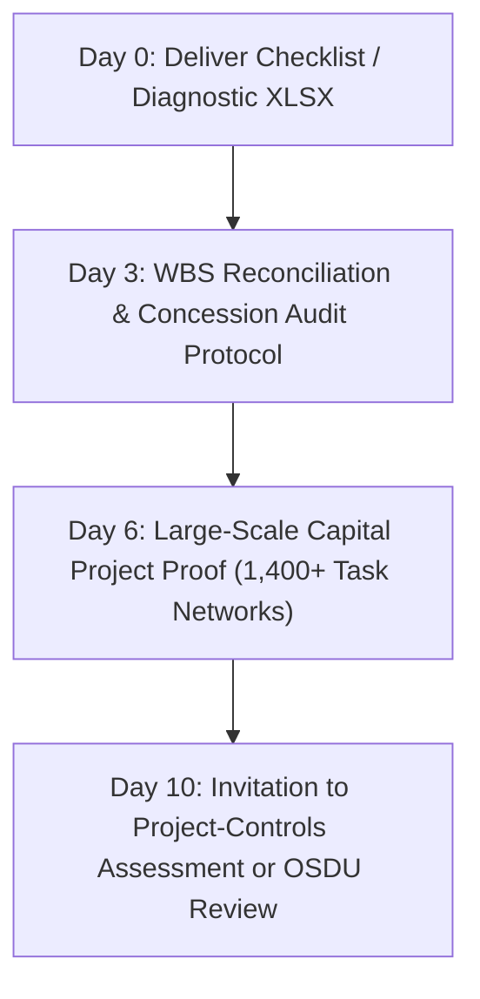

# Campaign Brief 03: Data & Project Controls (Egypt & North Africa)

**Campaign Name:** North Africa Capital Project Controls, JV Accounting & OSDU Readiness  
**Target Markets:** Egypt (EGPC / EGAS), Algeria (Sonatrach ecosystem), and Libya  
**Primary Focus:** Joint Venture Operating Companies, Capital Project PMOs, Exploration & Subsurface IT  
**Strategic Focus:** Expand into Egypt and North Africa following the initial West Africa and GCC campaign waves  

---

## 1. Campaign Objective & Core Offers

| Parameter | Specification |
|---|---|
| **Core Productized Offers** | **1. Project-Controls & JV Reporting Assessment** **2. OSDU Exploration Data Readiness Review** |
| **Conversion Assets (Lead Magnets)** | 1. Oil & Gas Project Controls / JV Reporting Checklist (`LM-02`) 2. OSDU Exploration Data Readiness Assessment (`LM-04`) |
| **Owner Pages** | `/en/industries/oil-and-gas/regions/north-africa` & `/en/industries/oil-and-gas/markets/egypt` |
| **Asset Deliverables** | `Deview_Project_Controls_JV_Checklist_v2026.xlsx` `Deview_OSDU_Readiness_Diagnostic_v2026.xlsx` |
| **Proof Anchors** | **1. Capital Project Scheduling Controls:** Historical enterprise capital scheduling architectures (e.g. Tomskneft & Gazprom Neft systems managing 1,400+ multi-tier schedule items and critical-path tracking across contractor packages). **2. Engineering Data Management:** Lukoil Engineering platform architecture reference (unifying technical document revisions and equipment hierarchies across complex operations). |
| **Target Next Actions** | 1. Book a Project-Controls & JV Assessment to map Primavera P6 WBS with ERP cost centers. 2. Schedule an OSDU Readiness Review to evaluate subsurface data silos and migration roadmaps. |

---

## 2. Target Accounts & Ideal Customer Profile (ICP)

### Primary Account Tiers:
- **Tier 1 (Egyptian Joint Venture Operators):** Belayim Petroleum Company (Petrobel - Eni/EGPC JV), Khalda Petroleum (Apache/EGPC JV), Badr Petroleum (Bapetco - Shell/EGPC JV), Gulf of Suez Petroleum (Gupco - Dragon Oil/EGPC JV), Agiba Petroleum, Qarun Petroleum.
- **Tier 2 (Algerian State & Partner Entities):** Sonatrach Upstream Division, Groupement Berkine (Sonatrach/Occidental), Groupement Timimoun, Sonatrach Engineering & Construction (GCP/ENAC).
- **Tier 3 (Regional Engineering Consultancies & EPCs):** Enppi (Engineering for the Petroleum & Process Industries), Petrojet, Petrofac North Africa, Saipem North Africa.

### Target Personas:
1. **Joint Venture Controller / Commercial Manager:** Responsible for reconciling multi-concession cash calls, joint billing statements, and ensuring expenditure complies with complex concession agreements.
2. **Capital Projects Director / PMO Lead:** Manages massive revamp, gas processing, or pipeline construction projects and struggles with reconciling contractor progress updates against Primavera P6 and SAP commitments.
3. **Chief Geoscientist / Exploration Data Manager:** Responsible for legacy physical tape archives, well logs (DLIS/LAS), and seismic volumes (SEG-Y), preparing to evaluate OSDU-compliant cloud repositories.

---

## 3. Core Narrative & Positioning

### The Pain Point:
In North Africa, mature oil and gas fields are heavily structured as operating Joint Ventures between national oil companies (EGPC, EGAS, Sonatrach) and international operators (Eni, Apache, TotalEnergies). 
- **Billing Bottlenecks:** Reconciling contractor work breakdown structures (WBS) between Primavera P6 schedules and SAP financial commitments takes weeks of manual ledger checking.
- **Data Fragmentation:** Decades of exploration data remain trapped in proprietary software formats or degrading physical magnetic tapes.

### Deview Solution & Customizability:
Deview builds **custom project-controls middleware and open subsurface data platforms**:
- **Automated P6-to-ERP Reconciliation:** Automatically validates contractor billable milestones against verified Primavera P6 percent-complete figures before invoices hit the ERP.
- **Multi-Partner Concession Accounting:** Automated audit trails that calculate joint venture share allocations according to contractual concession boundaries.
- **Vendor-Neutral OSDU Ingestion:** Formats well headers, seismic geometries, and core data into open OSDU schemas, liberating geoscientists from commercial software vendor lock-in.

---

## 4. Distribution Engine

### A. Founder-Led LinkedIn Publishing Schedule (3x / Week)

#### Post 1 (The JV Accounting Friction Point):
- **Hook:** *“Why joint venture audits in North Africa take six months: The gap between the P6 schedule and the general ledger.”*
- **Angle:** How disconnects between project work breakdown structures (WBS) and accounting cost centers cause billing disputes between national oil companies and international partners.
- **Asset CTA:** Link to download the *Oil & Gas Project Controls / JV Reporting Checklist*.

#### Post 2 (Subsurface Data & OSDU Reality):
- **Hook:** *“Is your organization truly ready for OSDU, or are your seismic and well headers still unstandardized?”*
- **Angle:** Teardown of the four prerequisites for OSDU migration: geodetic CRS harmonization, unique wellbore identifiers, DLIS curve standardization, and open API entitlements.
- **Asset CTA:** Link to take the *OSDU Exploration Data Readiness Diagnostic*.

#### Post 3 (Proof & Architecture Teardown):
- **Hook:** *“Managing 1,400+ project tasks across multi-contractor field developments: Architecture patterns for capital project controls.”*
- **Angle:** Technical patterns from enterprise capital scheduling systems: multi-tier milestone linking, critical path recalculation, and automated progress verification across engineering and procurement packages.
- **Offer CTA:** Book a *Project-Controls & JV Reporting Assessment*.

---

### B. Curated Account-Based Outreach to Egyptian JV Controllers & PMOs

#### Sample Outreach to Egyptian Joint Venture Operating Companies:
> *Subject: Reconciling Primavera P6 milestones with JV billing statements at [Operator]*  
> *Hi [First Name],*  
> *In operating joint ventures across Egypt's Western Desert and Gulf of Suez, commercial controllers frequently encounter friction when verifying contractor milestones between Primavera P6 schedules and SAP project accounting before billing international partners.*  
> *We developed an engineering audit checklist covering multi-partner JV allocation rules, WBS synchronization, and contractor commitment tracking:*  
> *https://deviewai.com/en/resources/oil-gas-project-controls-jv-reporting-checklist*  
> *This framework reflects our production experience delivering capital scheduling systems for large multi-package field developments (managing 1,400+ tasks). Would your commercial controls team be open to a 45-minute workflow assessment to identify reconciliation bottlenecks in your current pipeline?*  
> *Best regards,*  
> *[Deview Energy Practice]*

---

### C. 4-Step Email Nurture Sequence (Post-Download)

1. **Email 1 (Day 0 - Immediate Delivery):**
   - *Subject:* Your Deview Project Controls & JV Reporting Deliverable
   - *Body:* Direct download link to the spreadsheet workbook. Summary of the 5 audit categories (Schedule-to-cost WBS mapping, progress verification, JV cost recovery, dispute management, ICV tracking).
2. **Email 2 (Day 3 - Technical Implementation Guidance):**
   - *Subject:* How to prevent contractor milestone inflation before invoice submission
   - *Body:* Implementing automated percent-complete verification against physical deliverables (inspections, material receipts) rather than subjective contractor estimates.
3. **Email 3 (Day 6 - Operational Proof):**
   - *Subject:* Scaling project controls across multi-tier capital developments
   - *Body:* Case evidence from large-scale field scheduling platforms: multi-tier milestone linking, critical path recalculation, and contractor progress portals.
4. **Email 4 (Day 10 - Productized Conversion):**
   - *Subject:* Complimentary Project-Controls & JV Reporting Assessment for [Company]
   - *Body:* Invitation to map your team's P6, ERP, and joint billing interfaces with Deview's enterprise systems architects (`/en/contact?topic=project-controls-assessment`).

---

## 5. Metrics & Conversion Milestones (First 60 Days)

- **Target Downloads:** ≥35 combined downloads (JV Checklist + OSDU Diagnostic).
- **Qualified JV Operations Inquiries:** ≥15 commercial/technical decision-maker contacts.
- **Completed Assessments:** ≥4 Project-Controls Assessments or OSDU Readiness Reviews conducted.
- **Active Scoping / Tenders:** ≥1 joint venture reporting automation scoping project initiated.
