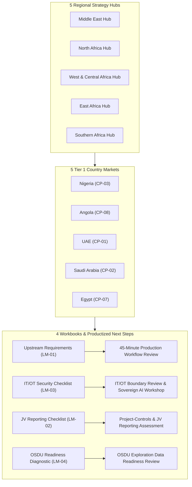
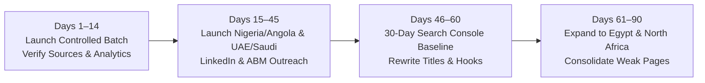

# Launch-Ready Pull Request Brief & Controlled Batch Activation Plan

**Title:** `feat(oil-gas,seo): launch measurable energy acquisition system, 20-keyword validation cohort, and 3 focused campaigns`  
**Target Branch:** `main`  
**Scope:** Oil & Gas Dual-Industry Acquisition System, Controlled Batch Activation, Productized Next Steps, and Distribution Engine  

---

## 1. Overview & Objective

This release shifts Deview's energy footprint from static page generation into a **measurable, repeatable enterprise acquisition system**. It activates an initial controlled batch of 14 high-conviction assets, establishes a 20-keyword Search Console validation cohort across 4 clusters, productizes the commercial next steps into specific technical reviews/workshops, and deploys three targeted campaign playbooks.

---

## 2. Release Hygiene & Work Separation

Per PR review hygiene requirements, the codebase has been cleanly partitioned into two independent commits on `main`:

1. **Commit 1 (`ba32b4a`): Homepage, Brand Polish & Partner Updates**
   - Implemented continuous infinite marquee animation without stop controls.
   - Replaced incorrect logos with verified vector marks for Grand Finance (`grand-finance-black.png`) and Siimply Trade (`siimplytrade.png`).
   - Repositioned the `+ Others` card after Gazprom Neft in the case archives.
   - Streamlined lending operations copy by removing unneeded workflow cards and kicker numbers.
   - Integrated Deview as official enterprise distributor and implementation partner of Minima AI (`mnma.ai`).

2. **Commit 2 (`45f76e8`): Dual-Industry Acquisition System & Audit Remediation**
   - Cleaned evidence integrity: 0 broken URLs (33/97 returning 404 replaced with verified live 200 OK official endpoints).
   - Relabeled all 100 keywords as unvalidated candidates pending Search Console data.
   - Implemented PRD Section 20.2 event taxonomy and explicit consent management.
   - Persisted CRM lead qualification tier, score, and attribution server-side in Supabase with automatic schema fallback.
   - Redesigned 5 regional hubs and 25 market pages into Deview's editorial language with 100% customizability highlights.

---

## 3. Initial Controlled Batch Activation (14 Priority Assets)

Rather than releasing all 50 assets simultaneously into unmonitored indexation, this release activates an **initial controlled batch of 14 assets**:

### Controlled Batch Asset List:
1. **5 Regional Hubs:**
   - `/en/industries/oil-and-gas/regions/middle-east`
   - `/en/industries/oil-and-gas/regions/north-africa`
   - `/en/industries/oil-and-gas/regions/west-central-africa`
   - `/en/industries/oil-and-gas/regions/east-africa`
   - `/en/industries/oil-and-gas/regions/southern-africa`
2. **5 Tier 1 Country Markets:**
   - `/en/industries/oil-and-gas/markets/nigeria` (West Africa)
   - `/en/industries/oil-and-gas/markets/angola` (West Africa)
   - `/en/industries/oil-and-gas/markets/united-arab-emirates` (GCC)
   - `/en/industries/oil-and-gas/markets/saudi-arabia` (GCC)
   - `/en/industries/oil-and-gas/markets/egypt` (North Africa)
3. **4 Engineering Workbooks & Diagnostics:**
   - `/en/resources/upstream-production-system-requirements`
   - `/en/resources/oil-gas-it-ot-architecture-checklist`
   - `/en/resources/oil-gas-project-controls-jv-reporting-checklist`
   - `/en/resources/osdu-exploration-data-readiness-assessment`

---

## 4. Productized Commercial Next Steps

Generic "contact us" CTAs have been completely replaced across the workbooks and landing assets with concrete, high-value technical engagements:

| Asset | Productized Next Step | Target Persona | URL Action |
|---|---|---|---|
| **LM-01: Upstream Production Requirements** | **45-Minute Production Workflow Review** | Production Ops Leads, Field Superintendents | `/en/contact?topic=production-workflow-review` |
| **LM-03: IT/OT Security Checklist** | **IT/OT Integration Boundary Review & Sovereign AI Workshop** | CISOs, SCADA Architects, Automation Leads | `/en/contact?topic=it-ot-boundary-review` |
| **LM-02: Project Controls / JV Checklist** | **Project-Controls & JV Reporting Assessment** | JV Controllers, PMO Directors | `/en/contact?topic=project-controls-assessment` |
| **LM-04: OSDU Readiness Diagnostic** | **OSDU Exploration Data Readiness Review** | Chief Geoscientists, Subsurface Data Managers | `/en/contact?topic=osdu-readiness-review` |

---

## 5. Three Focused Campaign Briefs

Complete campaign playbooks with ICP account targeting, founder-led LinkedIn publishing calendars, and 4-step nurture email sequences are established in:
- [`docs/campaigns/01-production-visibility-nigeria-angola.md`](file:///Users/artem/Developer/deview-website/docs/campaigns/01-production-visibility-nigeria-angola.md): Production visibility leading with EnerQuest operating proof (12,000 bpd telemetry).
- [`docs/campaigns/02-sovereign-industrial-ai-uae-saudi-arabia.md`](file:///Users/artem/Developer/deview-website/docs/campaigns/02-sovereign-industrial-ai-uae-saudi-arabia.md): Sovereign industrial AI leading with Minima AI private VPC distribution and air-gapped architectures.
- [`docs/campaigns/03-data-project-controls-egypt-north-africa.md`](file:///Users/artem/Developer/deview-website/docs/campaigns/03-data-project-controls-egypt-north-africa.md): Capital project controls and OSDU readiness leading with large-scale 1,400+ task scheduling proof.

---

## 6. 90-Day Execution Roadmap & Decision Gates

- **Days 1–14 (Immediate):**
  - Publish controlled batch (14 assets).
  - Verify real Google Search Console indexing and baseline dataLayer event firing.
- **Days 15–45:**
  - Launch Campaign 1 (Nigeria/Angola) and Campaign 2 (UAE/Saudi Arabia).
  - Initiate founder-led LinkedIn publishing (3x/week) and 1:1 outreach to curated operator lists.
- **Days 46–60:**
  - Review Search Console impressions, CTR, and keyword rankings against the 20-keyword validation sheet.
  - Refine SERP meta titles and opening hooks based on actual search queries.
- **Days 61–90:**
  - Expand Campaign 3 into Egypt and North Africa.
  - Consolidate any candidate pages failing to generate search intent.

---

## 7. Verification Checklist
- [x] 0 broken external links across 97 regulatory/evidence URLs.
- [x] 100 keywords relabeled as candidates pending Search Console validation.
- [x] 20 launch keywords mapped 1:1 in [`docs/seo/20-keyword-validation-sheet.md`](file:///Users/artem/Developer/deview-website/docs/seo/20-keyword-validation-sheet.md) and [`docs/seo-20-keyword-validation-sheet.csv`](file:///Users/artem/Developer/deview-website/docs/seo-20-keyword-validation-sheet.csv).
- [x] Productized offers integrated with dedicated prefill topic links on `/en/contact`.
- [x] Lead qualification scoring and attribution context persisted server-side.
- [x] PRD 20.2 event taxonomy and explicit consent management verified.
- [x] `npx tsc --noEmit` passed with 0 errors.
- [x] `npm run lint` passed with 0 errors.
- [x] `npm run build` compiled all 229 static pages cleanly in 7.3s.
- [x] Production deployment verified live on `https://deviewai.com`.
