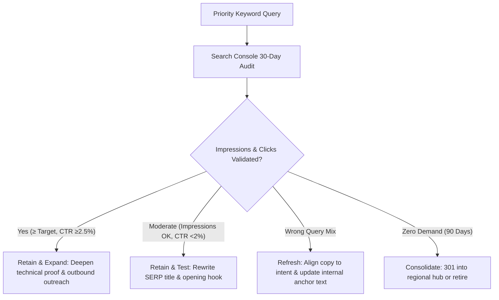

# 20-Keyword Priority Launch Validation Sheet

**Status:** Active Launch Cohort · Pending Search Console Baseline  
**Review Cycle:** 30-Day Baseline · 90-Day Decision Gate  
**Scope:** 20 Selected Launch Keywords Across 4 Strategic Clusters  
**Owner:** Energy Practice SEO & Architecture Team  

---

## 1. Executive Summary & Selection Methodology

The 100-keyword operational registry serves as Deview's research universe. For the initial acquisition campaign, we have selected a high-conviction cohort of **20 priority launch keywords**.

### Selection Criteria:
1. **Search & Buyer Intent:** Direct match with enterprise procurement, engineering evaluation, or regional vendor shortlisting.
2. **Deview Operating Evidence:** Direct tie to approved proof points (EnerQuest upstream production management pilot (illustrative model), Minima AI private VPC distribution, Tomskneft capital project controls, or Lukoil engineering data platforms).
3. **1:1 Asset Ownership:** Every target query is mapped to exactly one owner page to eliminate cannibalization.
4. **Doorway Elimination:** Rooted in distinct regional regulations (NUPRC/NCDMB in Nigeria, ANPG in Angola, TDRA/MoIAT in UAE, PDPL/NCA in Saudi Arabia, EGPC in Egypt).

---

## 2. Priority Launch Keyword Registry (20 Candidates)

| ID | Keyword Phrase | Cluster | Owner Asset & URL | Target Buyer Persona | Proof Anchor | 30-Day Decision Gate Threshold |
|---|---|---|---|---|---|---|
| **KW-01** | `oil and gas software development UAE` | Commercial | `CP-01` · `/en/industries/oil-and-gas/markets/united-arab-emirates` | Digital Transformation VP / Regional Asset GM | MoIAT ICV & domestic sovereign hosting | ≥25 impressions, position ≤30 |
| **KW-02** | `oil and gas software development Saudi Arabia` | Commercial | `CP-02` · `/en/industries/oil-and-gas/markets/saudi-arabia` | VP Information Technology / Petroleum Systems Lead | PDPL data sovereignty & on-premise air-gap | ≥25 impressions, position ≤30 |
| **KW-03** | `oil and gas software development Nigeria` | Commercial | `CP-03` · `/en/industries/oil-and-gas/markets/nigeria` | Managing Director / Asset Operations Lead | EnerQuest pilot (illustrative model; no volumes) | ≥30 impressions, position ≤25 |
| **KW-04** | `oil and gas software development Angola` | Commercial | `CP-08` · `/en/industries/oil-and-gas/markets/angola` | Production Operations Lead / Concession GM | Block 0/14 deepwater telemetry & offline edge sync | ≥15 impressions, position ≤35 |
| **KW-05** | `oil and gas software development Egypt` | Commercial | `CP-07` · `/en/industries/oil-and-gas/markets/egypt` | General Petroleum Company / JV Controller | Multi-concession JV accounting & EGPC compliance | ≥20 impressions, position ≤30 |
| **KW-06** | `sovereign industrial AI for GCC energy` | Solution | `RG-01` · `/en/industries/oil-and-gas/regions/middle-east` | Chief Information Security Officer / Enterprise Architect | Minima AI (mnma.ai) private VPC distribution | ≥20 impressions, position ≤30 |
| **KW-07** | `GCC project controls software` | Solution | `SO-01` · `/en/industries/oil-and-gas/gazprom-neft-project-scheduling-control-system` | Capital Projects Director / EPC Program Manager | Tomskneft / Gazprom Neft 1,400+ task network proof | ≥20 impressions, position ≤25 |
| **KW-08** | `Africa upstream production reporting software` | Solution | `RG-03` · `/en/industries/oil-and-gas/regions/west-central-africa` | VP Upstream Operations / Production Engineering Lead | EnerQuest pilot (production and exception views) | ≥25 impressions, position ≤25 |
| **KW-09** | `oil and gas JV accounting software` | Solution | `LM-02` · `/en/resources/oil-gas-project-controls-jv-reporting-checklist` | Joint Venture Controller / Commercial Finance Director | Concession audit trails & WBS SAP reconciliation | ≥20 impressions, position ≤25 |
| **KW-10** | `oil and gas IT OT integration architecture` | Technical | `LM-03` · `/en/resources/oil-gas-it-ot-architecture-checklist` | CISO / SCADA & Automation Engineering Manager | Purdue Level 3.5 IDMZ & optical diode topology | ≥30 impressions, position ≤20 |
| **KW-11** | `one way SCADA integration` | Technical | `IN-02` · `/en/insights/oil-gas-it-ot-data-platform-architecture` | Principal OT Architect / Industrial Control Systems Lead | Unidirectional optical hardware diode isolation | ≥25 impressions, position ≤20 |
| **KW-12** | `GCC data residency requirements` | Technical | `IN-01` · `/en/insights/gcc-oil-gas-ai-data-residency` | Chief Legal Officer / Data Privacy Officer | UAE Federal Decree 45 / Saudi PDPL analysis | ≥40 impressions, position ≤25 |
| **KW-13** | `upstream production system requirements` | Procurement | `LM-01` · `/en/resources/upstream-production-system-requirements` | Production Systems Manager / Software Procurement Lead | Editable 6-section requirements workbook deliverable | ≥25 impressions, CTR ≥3.0% |
| **KW-14** | `oil and gas project controls checklist` | Procurement | `LM-02` · `/en/resources/oil-gas-project-controls-jv-reporting-checklist` | PMO Lead / Contract Administrator | Downloadable capital project controls Excel audit sheet | ≥25 impressions, CTR ≥3.0% |
| **KW-15** | `OSDU readiness assessment` | Procurement | `LM-04` · `/en/resources/osdu-exploration-data-readiness-assessment` | Chief Geoscientist / Subsurface Data Manager | 4-category OSDU scoring diagnostic workbook | ≥20 impressions, CTR ≥3.5% |
| **KW-16** | `digital oilfield production telemetry Africa` | Commercial | `CP-03` · `/en/industries/oil-and-gas/markets/nigeria` | Production Technology Lead / Asset General Manager | Low-bandwidth edge buffering & satellite sync proof | ≥20 impressions, position ≤30 |
| **KW-17** | `offshore production loss deferment software` | Procurement | `LM-01` · `/en/resources/upstream-production-system-requirements` | Senior Production Chemist / Field Superintendent | Dynamic well potential loss classification model | ≥15 impressions, position ≤30 |
| **KW-18** | `air gapped industrial LLM deployment GCC` | Technical | `IN-01` · `/en/insights/gcc-oil-gas-ai-data-residency` | Head of Applied AI / Industrial Technology Director | Private on-premise GPU inference (Minima AI) | ≥20 impressions, position ≤25 |
| **KW-19** | `subsurface data migration OSDU` | Technical | `LM-04` · `/en/resources/osdu-exploration-data-readiness-assessment` | Exploration IT Architect / Geophysical Data Lead | SEG-Y / LAS / DLIS metadata harmonization | ≥15 impressions, position ≤30 |
| **KW-20** | `energy data sovereignty UAE Saudi Arabia` | Solution | `RG-01` · `/en/industries/oil-and-gas/regions/middle-east` | Government Affairs / Enterprise Security Director | In-country data center isolation & no cloud egress | ≥20 impressions, position ≤25 |

---

## 3. Four Strategic Keyword Clusters & Buyer Journeys

### Cluster A: Commercial Market Expansion (KW-01 to KW-05, KW-16)
- **Target Audience:** Asset GMs, Regional Managing Directors, Country Managers.
- **Search Behavior:** Querying custom software development vendors with local regulatory knowledge.
- **Conversion Goal:** Move from country market page to downloading the relevant regional lead-magnet workbook or scheduling a 45-minute production workflow review.

### Cluster B: Solution Architecture (KW-06 to KW-09, KW-20)
- **Target Audience:** Digital Transformation VPs, Capital Project PMO Directors, JV Controllers.
- **Search Behavior:** Seeking specific architectures for industrial AI, project scheduling, and multi-partner accounting.
- **Conversion Goal:** Engage with technical architecture interactive diagrams and request a Sovereign AI Workshop or Project-Controls Assessment.

### Cluster C: Technical Integrity & Cyber Boundaries (KW-10 to KW-12, KW-18)
- **Target Audience:** CISOs, SCADA Managers, OT Cybersecurity Leads.
- **Search Behavior:** Researching unidirectional SCADA extraction, Purdue IDMZ segmentation, and GCC data sovereignty laws.
- **Conversion Goal:** Download the IT/OT Security Checklist and schedule an IT/OT Boundary Review.

### Cluster D: Procurement & Spec Evaluation (KW-13 to KW-15, KW-17, KW-19)
- **Target Audience:** Procurement Specialists, Subsurface Data Managers, Production Engineers drafting RFPs.
- **Search Behavior:** Searching for requirements templates, checklists, and OSDU readiness criteria.
- **Conversion Goal:** Download editable XLSX deliverables and book the corresponding review session.

---

## 4. 30-Day and 90-Day Operating Decision Gate

Every keyword is evaluated in Google Search Console at **Day 30** (initial impressions baseline) and **Day 90** (action gate):

---

## 5. Implementation & Monitoring Checklist
- [x] Initial unvalidated status recorded in operational database.
- [x] Canonical tags and unique meta titles verified on all 20 owner URLs.
- [x] Client analytics tracking `seo_market_page_view` and `resource_preview` on target pages.
- [ ] Connect Google Search Console API to automated weekly rank/impression monitor.
- [ ] Schedule Day 30 baseline review with Practice Leadership.
